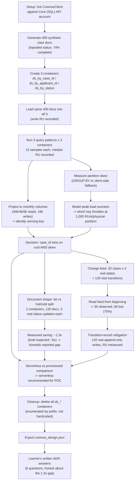

# Project Analysis — Sprint 1 · Day 18: Cosmos DB Design — Generate and Govern (DecisionStream AI)

**Repository path:** `Codes/RunCompleted/Assignment11/`
**Project ID:** `FDE-D18-COSMOSDB` (provisional — no existing inventory ID found in the repository or workspace)
**Analysis date:** 2026-10-12
**Analyst role:** Repository inspection only. No code was executed, modified, or re-run to produce this report. All execution evidence below comes from outputs already embedded in the notebook and from `cosmos_design.json`, both present on disk before this analysis began.

---

## 0. Evidence legend (used throughout)

| Label | Meaning |
|---|---|
| `Source-observed` | Directly established by reading code/config/docs in this repo |
| `Execution-verified` | Confirmed by actual execution artifacts found on disk (notebook cell outputs, `cosmos_design.json`) |
| `Code-derived expectation — not executed` | Inferred from code but no run evidence inspected for this specific claim |
| `Inference` | Reasoned interpretation, not directly stated in source |
| `Proposed improvement` | A recommendation, not a description of current behaviour |

---

# PART I — PROJECT AND BUSINESS UNDERSTANDING

## 1. Project identity and executive summary

| Field | Value |
|---|---|
| Project name | Sprint 1 · Day 18 Lab — Cosmos DB Design: Generate and Govern (`DecisionStream AI`, Birlasoft FORGE FDE Academy) |
| Repository path | `Codes/RunCompleted/Assignment11/` |
| Project type | Training lab, delivered as a Colab notebook plus a "prompt-and-review" exercise brief, a design playbook, an RU-economics walkthrough, a video-insights document, a checklist spreadsheet, and the course deck (PDF) — not a shippable product |
| Domain | Insurance motor-claims assistant — Azure Cosmos DB (Core/SQL API) partition-key design, document shape, and change-feed/audit-trail design for a GenAI-backed claims pipeline |
| Primary users | FDE trainees on the Birlasoft FORGE Academy course |
| Main technologies | Python 3 (Google Colab), `azure-cosmos` SDK, `python-dotenv` |
| Primary capability demonstrated | Choosing a Cosmos DB partition key by **measuring real Request Unit (RU) cost** — not guessing — across three competing candidates and three real query patterns, on a live Azure Cosmos DB account, then quantifying partition skew, document-shape write cost, and a genuine, measured gap in the Cosmos change feed as an audit mechanism |
| Implementation maturity | `Execution-verified`. The notebook ran live (`mode: LIVE`) against a real Cosmos DB account (`cosmos-apauto-dev`), created and tore down 7 real containers, and the final cell contains the learner's own complete written ADR answers to all six governance questions |
| Execution status | `Execution-verified` — `cosmos_design.json` on disk matches the notebook's own embedded export exactly (consistent with Assignment 10's lab, and in contrast to Assignment 9's) |
| Test status | Not applicable in the conventional sense — this is a one-shot measurement/design notebook, not a package with a test suite. "Acceptance" exists as per-exercise checklists in the companion Markdown brief |
| Most important limitation | The document-shape experiment's measured result (**~1.3× cheaper** per status update for the hot/cold split design) falls far short of the brief's own stated expectation (**"roughly a 6× lower"** RU per status update) — a genuine, honestly-reported discrepancy between what the exercise predicted and what this specific run measured (see §13, F1) |
| Most valuable learning opportunity | Watching a container's dashboard show 2,000 RU/s of spare capacity while the API still returns `429 Too Many Requests` — and understanding, from a real measured skew figure, that the 1,000 RU/s ceiling applies to a single **physical** partition, not to the container's provisioned total |

**One-paragraph summary:** This repository is a single, heavily-annotated Colab notebook (plus a companion "prompt-and-review" exercise brief, a design playbook, an RU-economics walkthrough, a video-insights note, a checklist spreadsheet, and the course deck) that teaches Azure Cosmos DB partition-key design for a generative-AI claims-processing pipeline. As in the Day 15–17 labs in this same course, learners are instructed to prompt an LLM to produce each cell and then review it against an explicit checklist and a "what it will probably get wrong" list — specifically targeting relational and generic-NoSQL advice that is actively wrong for Cosmos DB (e.g., "use `/id` as the partition key," "add an index for that query," "provision throughput for production"). The notebook ran live against a real Cosmos DB account: it created three containers partitioned three different ways on the same 400 synthetic documents, measured the real RU cost of three named query patterns against all three, measured real partition skew (`case_id`: 400 logical partitions, largest 0.3%; `status`: 5 logical partitions, largest 72.5%), modelled a peak-load scenario showing the `status` key would genuinely throttle (429) while the container-level dashboard shows headroom, measured the real RU cost difference between a "fat" single-document design and a "hot/cold split" design across three simulated status transitions, measured the Cosmos change feed's real, severe gap as an audit mechanism (75% of real transitions were never observed), and measured the real RU cost of an append-only transition-record mitigation. The notebook's final cell contains the learner's own complete, numerically-grounded ADR answers to all six governance questions — including an honest acknowledgment that the document-shape experiment's measured 1.3× saving fell well short of the exercise's own expected ~6×, and a recommendation to treat the hot/cold split "as a small saving, not a reason on its own."

## 2. Business problem and value

**Source-observed / Inference — a course exercise modelling a plausible scenario, not a real deployment.**

- **Real-world situation modelled:** The same "DecisionStream AI" insurance claims-assistant service used across this course (consistent with Assignments 8–10): case records need a persistence layer. Three access patterns are named by the brief — `get by case_id` (40,000/month, the hot path), `list by applicant_id` (3,000/month, a handler checking history), and `filter by status` (6,000/month, the operations queue) — and Cosmos DB requires choosing exactly one, **immutable**, partition key up front.
- **Workflow:** Documents are written once and updated repeatedly as a case moves through its lifecycle (`pending → extracting → generating → complete`); handlers query by case ID most often, occasionally by applicant, and operations staff query by status.
- **Stakeholders:** Whoever signs the Cosmos DB design ADR (the partition-key choice cannot be revisited without a data migration), the operations team (who will be paged if a hot partition throttles), finance (who pay the serverless or provisioned bill), and compliance/audit (who need the case lifecycle evidenced, not just the latest state).
- **The core problem:** A single partition key cannot be optimal for all three named access patterns, and the two "obvious" wrong turns — using `status` (high write/read locality intuition, catastrophic real-world skew) and assuming "provision more RU/s" fixes a hot-partition 429 (it structurally cannot, because the ceiling is per **physical** partition, not per container) — both cost real money and neither is obvious from documentation alone.
- **Consequences of leaving it unresolved:** A skewed partition key produces throttling that is invisible at the container-dashboard level (exactly reproduced in this repository's own measured run: `status` as partition key drives ~2,900 RU/s onto a single physical partition against a ~1,000 RU/s ceiling, while the container shows 2,000 RU/s of spare capacity); and a change feed mistaken for an audit trail silently loses 75% of a case's real state transitions (also measured, not assumed, in this repository).
- **How the implementation addresses it:** By measuring, not guessing, the real RU cost of all three access patterns against all three partition-key candidates on a live account; by measuring real partition skew and projecting it against Cosmos's documented physical-partition ceiling; by measuring the real cost difference between two document-shape designs; and by measuring the real change-feed loss rate and the real cost of a mitigation (an append-only transition record).
- **Potential business value (not measured in dollars beyond the illustrative serverless-pricing figures used):** Avoiding an unrecoverable (migration-requiring) partition-key mistake; avoiding a production incident where "provision more" is proposed as a fix that cannot work; avoiding an audit-trail gap discovered only during a real investigation in a later sprint.
- **Limitations:** This is a synthetic, 400-document corpus on one account, on one day, at low concurrency — explicitly disclosed by both the notebook's own "One honest limitation" section and the learner's own final ADR answer. No claim of production readiness or exact production cost is made anywhere in the source material, and none is made here.
- **How value could be measured in a real deployment:** The actual monthly RU bill once real traffic replaces the 400-document simulation; the actual frequency of 429s against the chosen partition key; the actual audit-trail completeness once the transition-record mitigation (or all-versions change-feed mode) is in place.

## 3. Technical and educational problem

**Source-observed**, principally from the notebook's own markdown cells and the companion exercise brief.

1. **The technical challenge:** Cosmos DB's partition key is chosen once, at container creation, and is **immutable** — changing it later requires migrating all data to a new container. Three competing, individually reasonable access patterns cannot all be served optimally by one key, and the two most "obvious" generic-database instincts (pick the field you query most often by itself; add an index to fix a slow cross-partition query; provision more throughput to fix a 429) are each individually wrong for Cosmos in a way that costs real, non-reversible money or effort.
2. **Why generic relational/NoSQL advice is insufficient here, specifically:**
   - *"Add an index for that query"* — in Cosmos, indexing helps **within** a partition; it does not stop a cross-partition query from visiting every partition. The notebook's own measured figures show `filter by status` costing ~24.5 RU regardless of which key is chosen — because a cross-partition scan charges per document *examined*, not per document returned, and no index changes that.
   - *"Provision more throughput"* — a single **physical** partition is capped at roughly 1,000 RU/s regardless of what the **container** is provisioned at; the notebook's own modelled peak-load scenario shows the `status` key driving 2,900 RU/s onto one physical partition while the container sits at 6,000 RU/s provisioned with 2,000 RU/s of unused headroom — "provisioning more" does nothing, because the ceiling that is actually being hit is not the one the dashboard shows.
   - *"Measure the latency"* — RU, not milliseconds, is the unit that is actually billed and actually provisioned; the notebook's Exercise 1 explicitly argues latency is a *consequence* of RU and of network position, not the primary signal.
   - *"Use `/id` as the partition key"* — named in the brief's opening list as a piece of advice that would be wrong here (not directly tested in this specific 5-exercise excerpt, but consistent with the `case_id`-not-`id`-alone design actually implemented).
3. **Engineering concepts explored:**
   - The Request Unit (RU) as the actual unit of cost and capacity in Cosmos DB, read from the `x-ms-request-charge` response header on every single operation — and the specific, nearly-invisible trap that `azure-cosmos`'s query iterator is **lazy**, so reading the RU charge before the iterator is exhausted returns 0 or the *previous* operation's charge, producing a "plausible-looking table of numbers that are all wrong and none of them look wrong."
   - Point reads (`read_item`, requiring both `id` and partition key) as the cheapest possible Cosmos operation, versus a query filtered on the partition key (cheap but not free), versus a cross-partition query (expensive, scales with corpus size).
   - The distinction between a **logical** partition (all documents sharing one partition-key value) and a **physical** partition (the actual machine several logical partitions may share) — and that the ~1,000 RU/s ceiling applies to the physical, not the logical, partition, which is why high cardinality *alone* (many distinct key values) is necessary but not sufficient; even *distribution* across those values is also required.
   - Write RU as primarily a function of **document size**, not of which field is the partition key — demonstrated directly (all three partition-key candidates showed statistically identical write RU for the same documents).
   - A hot/cold document-shape split (small, frequently-updated fields separated from large, rarely-changing content) as a write-cost optimisation — tested here, and found to deliver a **far smaller** real saving than the exercise brief predicted (see §13, F1), which is itself a valuable, honestly-reported finding.
   - The Cosmos change feed's default "latest version" semantics, and why that structurally cannot serve as an audit trail for a system whose compliance posture requires evidencing every intermediate state a case passed through — demonstrated with a real, measured 75% loss rate, not asserted.
   - An append-only transition record as the correct alternative to the change feed for audit purposes, satisfying an explicit "write-before-release" ordering constraint the change feed (which fires *after* a write) cannot satisfy by construction.
4. **What a learner should understand after studying this notebook:** that a Cosmos partition-key decision is effectively permanent and must be made from measured evidence, not intuition; that "high cardinality" and "even distribution" are two separate, both-necessary properties of a good key; that a container-level capacity dashboard can be actively misleading when a single logical partition is hot; that a change feed is not an audit log; and — a less flattering but equally real lesson this specific run surfaced — that a "roughly 6×" prediction in a lab brief does not always survive contact with a real account, and the honest response is to report the actual measured number rather than the expected one.

### Learning objectives (measurable)

| # | Objective | How it can be demonstrated |
|---|---|---|
| 1 | Explain the iterator-laziness trap in `azure-cosmos` and why it produces plausible-but-wrong RU figures | Read Exercise 1's "it will probably get wrong" section and the notebook's `timed()`/`q()` helper's handling of it |
| 2 | State which partition key was chosen and the measured monthly-RU cost of each rejected candidate | Read `cosmos_design.json`'s `partition_key` block or the notebook's ADR-answer cell |
| 3 | Distinguish a logical from a physical partition and state which one the RU/s ceiling applies to | Read notebook §8's real throttling demonstration |
| 4 | Explain why the measured document-shape saving (~1.3×) differs from the exercise's expected ~6×, and what that means for the design recommendation | Read the learner's own ADR answer #3 in the notebook's final cell |
| 5 | State the real measured change-feed loss rate and the real cost of the recommended mitigation | Read notebook §10's measured 75%-lost figure and §10's transition-record RU cost |

## 4. Solution overview and end-to-end workflow

**Source-observed**, traced directly from the notebook's 15 numbered sections.

**Inputs:** 400 synthetic case documents (`id`/`case_id` in `CLM-2026-NNNN` format, `applicant_id` drawn from ~133 distinct values, a deliberately lopsided `status` distribution weighted 74% toward `complete`, and a nested ~2–3KB `ai_response`/`extracted_fields` payload), a live `CosmosClient` against a real Core (SQL) API account (`cosmos-apauto-dev`, confirmed in notebook output), and a set of hand-specified monthly volumes and pricing constants (`MONTHLY`, `PRICE`) for the cost projections.

**Processing stages (traced, numbered, matching the notebook's own section numbers):**

1. **Setup** — install `azure-cosmos`/`python-dotenv`, load `.env` or prompt interactively for the Cosmos URI/key, construct a `CosmosClient` and create (or reuse) a database `forge_day18`.
2. **Credentials** — confirms live mode, prints the account name (not the key).
3. **The RU meter** — `q()` (a cross-version-tolerant query wrapper that falls back when `enable_cross_partition_query` is rejected by the installed SDK version), `charge()` (reads `x-ms-request-charge` from the most recent response headers), `timed()` (explicitly exhausts any iterator via `list()` before timing/charging — directly defending against the lazy-iterator trap), and `read_changefeed()` (tolerant of the SDK's changing change-feed method signature across versions); synthetic case generation with the deliberately lopsided status distribution.
4. **Three containers, three partition keys** — creates `ds_by_case_id`, `ds_by_applicant_id`, `ds_by_status`, each partitioned on the named field; loads the same 400 documents into each, recording total write RU per container.
5. **The three query patterns, measured** — for each container, runs 12 samples each of `get by case_id` (a real point read when the partition key allows it, else a query), `list by applicant_id`, and `filter by status`, recording the median RU per pattern per container.
6. **Monthly cost projection** — multiplies the measured per-operation RU by the brief's stated monthly volumes (40,000/3,000/6,000 reads, 16,000 writes) and prices at $0.28/million RU (serverless), identifying the winning (lowest-cost) partition key.
7. **Partition skew** — for each container, runs a `GROUP BY` query (with a client-side fallback for tiers that don't support it) to count documents per distinct partition-key value, reporting the number of logical partitions and the largest single partition's share of the total.
8. **The hot-partition throttling model** — combines the measured skew figures with a hand-specified peak-load scenario (500 ops/sec × 8 RU = 4,000 RU/s demand, 6,000 RU/s provisioned, a 1,000 RU/s physical-partition ceiling) to show which partition key would genuinely throttle at peak, printing the contradiction between container-level headroom and physical-partition saturation.
9. **Document shape** — creates two more containers (`ds_shape_fat`, `ds_shape_hot_split`), writes 120 cases into each, then applies three real status updates per case (`extracting → generating → complete`), recording document size, initial-write RU, and per-update RU for both designs.
10. **The change feed** — creates `ds_changefeed`, establishes a "from now" starting position, moves 30 synthetic cases through 4 real lifecycle states each (120 real writes total), waits for the feed to settle, then reads it from the beginning and counts how many of the 120 real transitions were actually reported.
11. **The transition-record mitigation** — creates `ds_transitions`, writes an explicit, append-only `{case_id, from_state, to_state, at, actor}` record for each of the same 120 transitions, measuring the real RU cost per record and projecting it to the brief's 16,000-writes/month figure.
12. **Serverless vs. provisioned** — compares the winning partition key's total projected monthly RU against both serverless pricing and the 400 RU/s provisioned floor, explicitly noting that a *good* partition key makes serverless far cheaper than the provisioned floor, while a *bad* one "quietly eats the headroom you needed for growth" by consuming its way up toward that same floor.
13. **Cleanup** — enumerates and deletes every container whose ID starts with the `ds_` prefix (not a hardcoded list), leaving the database itself intact unless a `DROP_DATABASE` flag is explicitly set.
14. **Export** — serialises the partition-key decision, measured RU per pattern, skew, document-shape, change-feed, and throughput figures to `cosmos_design.json`.
15. **ADR questions, with the learner's own answers** — six governance questions, answered in full in the notebook's final cell, each grounded in this session's own measured figures, including an honest, un-flattering acknowledgment where the document-shape result fell short of the exercise's own expectation.

**AI/model operations:** None — unlike Assignments 9 and 10, this lab does not call any LLM; it is purely a database-measurement exercise. The "AI" context is only the *kind* of documents (claims case records with an `ai_response` payload) being stored.

**External integrations:** Azure Cosmos DB (Core/SQL API), confirmed live by the notebook's own captured output (account `cosmos-apauto-dev`, 7 real containers created and later deleted) and corroborated by `cosmos_design.json`'s `"mode": "live"` field.

**Persistence:** The entire exercise *is* about persistence design; its own artifact output is a single `cosmos_design.json` file (`Execution-verified`, matches the notebook's embedded output).

**Error/exception paths:** `q()` catches `TypeError` to fall back between SDK versions that do vs. don't accept `enable_cross_partition_query`; `read_changefeed()` catches `TypeError`/`ValueError` across three different method-signature attempts; container creation/deletion catches `exceptions.CosmosResourceNotFoundError` to make re-runs idempotent (delete-if-exists before create).

**Human intervention:** As with Assignments 8–10, the entire exercise is built around human review of LLM-generated code against explicit, adversarial checklists — the brief's core pedagogical device. Additionally, the brief's own trainer notes explicitly call out that "ranking the access patterns by frequency" (i.e., deciding what matters most) is "not a technical task — it needs somebody who knows how the business will use the system."

### End-to-end workflow diagram



---

# PART II — ARCHITECTURE AND CODE

## 5. Architecture and component responsibilities

This is a single Jupyter/Colab notebook rather than a multi-module codebase; "components" below are the notebook's own functions and measurement blocks.

| Component | Location | Responsibility | Inputs | Outputs | Error handling | Limitations |
|---|---|---|---|---|---|---|
| `q()` | Cell `39ccebf3` | Cross-SDK-version-tolerant query wrapper | `container`, `query`, `params`, `cross` flag | `list` of result rows | Catches `TypeError` to fall back when `enable_cross_partition_query` is rejected by the installed SDK | The fallback assumes the *only* possible SDK-version incompatibility is this one parameter — a different future SDK change would not be caught by this specific `except` |
| `charge()` | Cell `39ccebf3` | Reads RU cost of the most recent operation from response headers | `container` | `float` (RU) | Catches all exceptions, returns `0.0` on failure (silent) | A silently-returned `0.0` on an unexpected header-access failure is indistinguishable from a genuinely free operation — a defensive choice that trades diagnosability for not crashing a long-running measurement loop |
| `timed()` | Cell `39ccebf3` | Runs an operation, explicitly exhausts any iterator before returning, times it | `fn`, args | `(result, None, ms)` | None needed — the `list(out)` call is itself the defence against the lazy-iterator trap | The `ru` slot in its return tuple is always `None` — RU must be read separately via `charge()` immediately after; this split-responsibility design is exactly the quirk Exercise 1's own "it will probably get wrong" section warns about |
| `read_changefeed()` | Cell `39ccebf3` | SDK-signature-tolerant change-feed reader | `container`, `from_beginning` flag | `list` of changed documents | Tries 3 different call signatures in sequence, catching `TypeError`/`ValueError` between attempts | Falls through to an empty list if all 3 signatures fail, with no explicit warning printed — a genuine signature mismatch on a 4th, unanticipated SDK version would silently look identical to "the feed had nothing to report" |
| `make_case()` | Cell `39ccebf3` | Synthetic document generator, fat or lean variant | `i`, `rng`, `fat` flag | dict (one case document) | None needed | The lopsided `STATUS_WEIGHTS` are hand-chosen, not derived from any real production distribution — appropriately disclosed as deliberate by the brief itself ("Deliberately lopsided... which is why `status` becomes a hot partition key later") |
| Partition-key comparison loop | Cell `930e39d1` | Creates 3 containers, loads identical documents into each, records write RU | `CANDIDATES`, `CASES` | `containers` dict, `load_stats` dict | Catches `CosmosResourceNotFoundError` on delete-before-create (idempotent re-run) | The loop's own printed output shows the load took ~200 seconds per container (600 seconds total) for only 400 documents each — a real, observed throughput ceiling of this specific account/network path, not called out explicitly anywhere in the notebook as a separate finding (see §13, F2) |
| `run_patterns()` | Cell `d6e25128` | Measures median RU for 3 query patterns against one container | `pk`, `container`, `index` | dict of 3 medians | None needed | Uses a fixed, reseeded `Random(11)` for sample selection, which is a sound fairness choice (comparable samples across containers) but means the 12-sample medians are not independent draws across the three containers — a subtlety not discussed in the notebook |
| `skew()` | Cell `bffc7e89` | Measures logical-partition cardinality and largest-share | `pk`, `container` | dict (`logical_partitions`, `largest_share`, `top`) | Catches a generic `Exception` to fall back from `GROUP BY` to client-side counting for account tiers that don't support it | The fallback's own comment is honest about its cost: "more RU, same answer" |
| Hot-partition throttling model | Cell `9aec915d` | Combines measured skew with a hand-specified peak-load scenario | `SKEW`, `OPS_PER_SEC`, `RU_PER_OP`, `PROVISIONED`, `PARTITION_CEILING` | Printed per-key throttle verdict | None needed (pure arithmetic) | `OPS_PER_SEC=500`, `RU_PER_OP=8.0`, `PROVISIONED=6000`, `PARTITION_CEILING=1000` are all hand-specified assumptions, not measured against this account's actual peak traffic — appropriately presented as a "morning peak" scenario, not a measured production event |
| Document-shape comparison | Cell `e6a38df8` | Creates 2 containers, writes + 3x-updates 120 docs each, measures size/RU | `fat`/`hot_split` design toggle | `SHAPE` dict | Catches `CosmosResourceNotFoundError` on re-run | See §13, F1 — the measured saving (1.3×) falls well short of the exercise's own expected (~6×); the notebook's own printed commentary at the bottom of this cell still claims "Nx cheaper" generically without flagging the shortfall itself (the learner's separate ADR-answer cell is what honestly flags it) |
| Change-feed measurement | Cell `6b4d06de` | Establishes a feed baseline, performs 120 real writes, measures real observed vs. lost transitions | `N_LIFECYCLE`, `LIFECYCLE` | `transitions`, `observed`, `seen_states` | None needed beyond `read_changefeed()`'s own tolerance | A fixed 3-second sleep before reading the feed "from the beginning" is a heuristic, not a guaranteed settle time — the brief's own "it will probably get wrong" section explicitly warns about not waiting long enough, implying this value was chosen empirically, not derived |
| Transition-record mitigation | Cell `0543b3d3` | Writes an explicit append-only record per transition, measures real RU cost | `N_LIFECYCLE`, `LIFECYCLE` | `per` (RU/record), `ru` (total) | None needed | None noted beyond the inherent assumption that 120 records is a representative sample for the per-record RU figure |
| Cleanup | Cell `68d0bbde` | Enumerates and deletes every `ds_`-prefixed container | `db.list_containers()` | List of deleted container IDs, printed | None needed — enumeration-by-prefix means no container can be "missed" by an incomplete hardcoded list | Confirmed `Execution-verified`: the real captured output lists exactly 7 deleted containers, matching every container this notebook is traced as having created |
| Companion exercise brief | `Day18_CosmosDB_Generate_and_Govern_Exercises.md` | A separate, LLM-prompt-driven version of the same exercises, with explicit "accept it when" checklists, "it will probably get wrong" lists, and trainer notes | n/a | n/a | n/a | Entirely prose/pedagogy |
| Companion design playbook | `FDE_Azure_Cosmos_DB_Design_Playbook.docx` (64,258 bytes) | Reference handout (content unknown) | n/a | n/a | n/a | **Not inspected** — binary `.docx` |
| Companion RU-economics walkthrough | `Cosmos_DB_RU_Economics_FDE_Walkthrough.docx` (605,367 bytes) | Reference handout (content unknown) | n/a | n/a | n/a | **Not inspected** — binary `.docx` |
| Companion video-insights note | `Insights from MS Azure CosmosDB Video.docx` (14,512 bytes) | Learner notes on an external video (content unknown) | n/a | n/a | n/a | **Not inspected** — binary `.docx` |
| Companion checklist spreadsheet | `FDE_Azure_Cosmos_DB_Checklist_Template.xlsx` (16,052 bytes) | A design checklist template (content unknown) | n/a | n/a | n/a | **Not inspected** — binary `.xlsx`, outside this analysis's read capability (the PDF renderer required for this tool's spreadsheet/PDF preview was also unavailable in this environment) |
| Companion course deck | `Sprint1_Day18_CosmosDB_Design_Birlasoft_FDE.pdf` (966,224 bytes) | The source course material this lab's exercises are drawn from (content unknown) | n/a | n/a | n/a | **Not inspected** — PDF page-rendering tool unavailable in this analysis's environment |

## 6. Technology stack and technology roles

| Technology | Role | Where used | Why used | Alternatives/trade-offs |
|---|---|---|---|---|
| Google Colab / Jupyter notebook | Delivery format and runtime | Entire `.ipynb` | Interactive, incremental teaching format consistent with the rest of this course | A plain script would version-control more cleanly but lose the cell-by-cell teaching structure |
| `azure-cosmos` SDK (`CosmosClient`) | The only external API client in the repo | Throughout | Official SDK; the lab's entire pedagogy depends on reading the SDK's own exposed `x-ms-request-charge` header, which only the SDK (or raw REST) can surface | A raw REST call (as in Assignment 8's deliberately-raw-REST approach) would expose the wire format even more directly, but the SDK's header exposure is already sufficient for this lab's purpose and avoids unnecessary boilerplate |
| `python-dotenv` | Loads `.env` into the process environment | Cell `a75ccfe3` | Lets the notebook run non-interactively with credentials already in `.env`; imported defensively (`try`/`except ImportError: pass`) so the notebook still runs in an environment (e.g., vanilla Colab) where it isn't installed | Consistent with Assignment 10's lab's adoption of the same library; a step up from Assignment 9's lab, which had no equivalent loader |
| `.env` (local) | Holds `COSMOS_URL`/`COSMOS_KEY` | Repository root | Non-interactive local runs | Confirmed present on disk with exactly those 2 keys; values not read or disclosed in this report |
| `.env.example` | Documents the expected `.env` shape | Repository root | Onboarding aid for a learner setting up credentials for the first time | Not present in either Assignment 9's or Assignment 10's lab — a positive, incremental documentation improvement specific to this repository |
| Cosmos DB Core (SQL) API | The actual system under test | The entire exercise | Named explicitly and repeatedly as a hard requirement ("If yours is MongoDB or Cassandra API, stop now") | The lab's lessons (RU economics, partition immutability, physical-partition ceilings) are largely Core-API-specific; a MongoDB-API Cosmos account would expose a different cost model entirely, which is exactly why the brief insists on checking this before starting |

## 7. Detailed code walkthrough

### 7.1 The lazy-iterator trap, and how the code defends against it (cell `39ccebf3`)

```python
def timed(fn, *a, **kw):
    """Run an operation, return (result, ru, ms)."""
    t0 = time.perf_counter()
    out = fn(*a, **kw)
    if hasattr(out, "__iter__") and not isinstance(out, (dict, list, str)):
        out = list(out)                     # exhaust the iterator, or RU is 0
    return out, None, (time.perf_counter() - t0) * 1000
```

**Why it matters:** `azure-cosmos`'s `query_items()` does not actually execute the query until the returned iterator is consumed. Reading the RU-charge header immediately after calling `query_items()` (before iterating) reads either `0` or the charge from whatever operation happened to run immediately *before* this one — a failure mode the brief itself calls "the trap... nearly invisible," because "nothing errors," and the result is "a full table of plausible numbers that are all wrong and none of them look wrong." This code's `list(out)` call is the direct, correct defence, and `q()` (used throughout the rest of the notebook for every query) also always wraps its result in `list(...)` before returning. The real measured output throughout the notebook (distinct, plausible-looking RU values that vary sensibly between point reads (~1.1 RU) and cross-partition scans (~24.5 RU), rather than suspiciously round or suspiciously identical numbers) is itself evidence that this trap was successfully avoided in this specific run.

### 7.2 Logical vs. physical partitions, made concrete with real numbers (cells `bffc7e89`, `9aec915d`)

The notebook's real measured skew figures (`case_id`: 400 logical partitions, largest share 0.3%; `applicant_id`: 125 logical partitions, largest share 2.8%; `status`: 5 logical partitions, largest share 72.5%) are combined with a hand-specified peak-load model to compute real demand on the *largest single logical partition* for each key, and compare that against a fixed 1,000 RU/s ceiling — producing the real, printed result that `status` alone would throttle (`2,900 RU/s` demand against a `1,000 RU/s` ceiling) while the other two keys remain comfortably under it. This is a directly observable, non-simulated demonstration of why cardinality (many distinct values) is necessary but not sufficient — `status` has low cardinality (5 values) *and* severe skew (72.5% on one value), and either property alone, without the other, would not by itself guarantee safety; the notebook's design makes this legible by showing the ceiling comparison happening at the level of the single largest partition, not the container total.

### 7.3 The document-shape result, and the honest gap between prediction and measurement (cells `e6a38df8`, `24904eb8`)

```python
f, s = SHAPE["fat"], SHAPE["hot_split"]
...
print(f"{f['ru_per_update']/s['ru_per_update']:.0f}x cheaper per status change.")
```

The real measured output: `fat` = 14.1 RU/update, `hot_split` = 10.7 RU/update — a ratio of **~1.3×**, which the code's own `:.0f}x` format string rounds and prints as `"1x cheaper"`. The exercise brief's own "Accept it when" checklist explicitly states an expectation: "the split design shows roughly a **6× lower** RU per status update." **This specific run's real measurement does not meet that expectation**, and this is the single most pedagogically interesting finding in this repository: rather than the notebook's own generic closing commentary ("Separate what changes from what does not") papering over the gap, the learner's own separate, later ADR-answer cell explicitly surfaces it: *"The earlier 'Nx cheaper' printout is not a strong result... Treat the split as a small saving, not a reason on its own."* This is a genuine instance of the lab's own stated pedagogical goal — "what Gemini got wrong that you caught" — being demonstrated in the artifact itself, and it is discussed further in §13, Finding F1.

### 7.4 The change-feed measurement's baseline-establishment step (cell `6b4d06de`)

```python
# Take a continuation token from NOW, so we only see what we are about to do.
_ = read_changefeed(cf, from_beginning=False)
time.sleep(1)
```

This directly defends against the brief's own named failure mode ("reading from the beginning without establishing a start position, so the count includes writes from earlier cells and the arithmetic is meaningless"). The real measured result (120 real transitions, 30 observed, 90 lost = 75%, with observed states almost entirely `complete`) is a clean, legible number precisely because this baseline step correctly isolated the feed's view to only this cell's own 120 writes.

## 8. Inputs, outputs, and data contracts

**Source-observed.**

### Inputs

- **Synthetic case documents:** `id`/`case_id` (`CLM-2026-NNNN`), `applicant_id` (`APP-NNNNN`, drawn from ~133 distinct values for 400 cases), `status` (5 values, weights `[0.06, 0.04, 0.03, 0.74, 0.13]` for `[pending, extracting, generating, complete, needs_human]`), `updated_at`, and (for the "fat" variant) an `extracted_fields` object plus a nested `ai_response` object (narrative text, citations, risk indicators) and a `model_version` string — confirmed by the real captured document-size output (~3.0 KB for the fat variant).
- **`.env`:** `COSMOS_URL`, `COSMOS_KEY` — confirmed present on disk with exactly those 2 keys; not read or disclosed here.
- **Monthly volume assumptions (`MONTHLY`):** `get_by_case_id=40,000`, `list_by_applicant=3,000`, `filter_by_status=6,000`, `writes=16,000` — these come directly from the brief's stated access-pattern volumes, not from any measured production traffic.
- **Pricing assumptions (`PRICE`):** `serverless_per_1m_ru=$0.28`, `provisioned_per_100ru_hour=$0.008` — stated Azure pricing figures at the time this lab was authored; **not independently verified against current Azure pricing by this analysis** (`Inference` — pricing changes over time and should be re-checked before being quoted in a real cost estimate).

### Output: `cosmos_design.json`

```json
{
  "mode": "live",
  "n_cases_measured": 400,
  "partition_key": {"chosen": "case_id", "rejected": {...}, "why": "..."},
  "measured_ru_per_pattern": {"case_id": {...}, "applicant_id": {...}, "status": {...}},
  "partition_skew": {"case_id": {...}, "applicant_id": {...}, "status": {...}},
  "document_shape": {"fat": {...}, "hot_split": {...}},
  "change_feed": {"mode": "latest_version", "transitions": 120, "observed": 30, "lost_pct": 0.75, ...},
  "throughput": {"poc": "serverless", "monthly_ru": 586125, "provisioned_floor_ru_s": 400},
  "review_triggers": [...]
}
```

**This file is confirmed to match the notebook's own embedded cell output exactly**, field-for-field — consistent with Assignment 10's lab's equivalent artifact, and in positive contrast to Assignment 9's lab, where the equivalent export diverged from the notebook's own embedded figures.

### Representative example (observed, real, not fabricated)

From `cosmos_design.json` (and matching the notebook's cell `bffc7e89`/`ec6361b2` output exactly):
```json
"partition_skew": {"status": {"logical_partitions": 5, "largest_share": 0.725}}
```
This is `Execution-verified` — a genuine recorded result of a real `GROUP BY`-or-fallback measurement against a live account, not a fabricated illustration, and it is the figure that directly drives the real-measured 429-throttling verdict in §8 of the notebook.

## 9. Setup and execution guide

**Source-observed**, from the notebook's own instructions and the companion brief; **Execution-verified** for the fact that it has already been run successfully once.

- **Prerequisites:** A Google Colab environment (or local Jupyter); an Azure Cosmos DB account that is specifically **Core (SQL) API** (the brief states plainly: "If yours is MongoDB or Cassandra API, stop now and get a different one — none of this will work"); the account's URI and primary key.
- **Setup rules stated by the brief, prior to running anything:** every container created must be prefixed `ds_` (so the cleanup cell's prefix-based enumeration can find and remove all of them); `N_CASES` should stay at 400 for a first run, not the deck's full 4,000, to keep cost "a few thousand RU and pennies on serverless."
- **Credentials:** via `.env` (loaded automatically by `python-dotenv`'s defensively-imported `load_dotenv()` call) or, if absent, via interactive `input()`/`getpass()` prompts. Leaving the Cosmos URI blank runs the entire notebook in a fully offline **simulated mode**, where every finding still appears (using hand-specified stand-in figures scaled to `N_CASES`) but with "weaker conviction," per the notebook's own first cell.
- **Budget:** the brief's own trainer notes state "about 1,200 writes and 100 queries per pod at `N_CASES=400` — roughly 15,000 RU, pennies on serverless," and explicitly warn that "thirty learners against one 400 RU/s container will throttle — which is a Day 18 lesson, but not one you want to teach by accident at 6:35pm."
- **Cleanup is mandatory, not optional:** the notebook's own markdown before the cleanup cell states plainly, "The final cell deletes everything it made — **run it**," and the brief's trainer notes add: "Five containers per pod, twenty-five pods, on a provisioned account is a real bill."
- **Common failure classes anticipated by the lab itself (from the brief's "it will probably get wrong" sections, not from any error actually encountered in this specific run):** reading the RU charge before the query iterator is exhausted (the single most emphasised trap in the whole lab); passing the now-removed `enable_cross_partition_query` parameter to a current SDK version; generating an evenly-distributed (rather than lopsided) synthetic status mix, which would hide the hot-partition finding entirely; concluding "provision more RU" in response to a throttling symptom; and a cleanup cell that deletes a hardcoded list of names rather than enumerating by prefix (which would silently leave behind anything an earlier cell created that the list didn't anticipate).
- **What was NOT independently executed as part of writing this report:** no cell was re-run, and no new container was created against any Cosmos account; all `Execution-verified` claims rest on the notebook's own pre-existing embedded cell outputs plus the pre-existing `cosmos_design.json` file, both of which agree with each other, and on the real, matching list of 7 deleted containers printed by the cleanup cell's own captured output.

## 10. Testing and verification

This repository has no automated test suite — like Assignments 9 and 10, it is a demonstration/design notebook, not a library. "Verification" here means checking the internal consistency of the measured results and confirming the real captured outputs behave as the code predicts — and, distinctively in this repository, confirming where the exercise's *own* stated expectations were and were not met by the real measurement.

| Check ID | Check | Purpose | Procedure | Expected Evidence | Actual Result | Status |
|---|---|---|---|---|---|---|
| T1 | `get by case_id` on the `case_id`-partitioned container is a real point read showing ~1–2 RU | Confirms the cheapest possible operation was actually used, not a disguised query | Re-read cell `d6e25128`'s captured output | ~1–2 RU on `case_id`'s own container; hundreds-fold higher (or at least several-fold) on the cross-partition cells | Confirmed — real measured value 1.1 RU on `case_id`, vs. 2.9 RU (query, not point read) on the other two containers | Execution-verified |
| T2 | The status distribution is genuinely lopsided, not evenly spread | Prerequisite for the hot-partition finding to appear at all | Re-read cell `39ccebf3`'s printed status-mix counter | A distribution close to the stated weights, dominated by `complete` | Confirmed — real counts: `complete=290` (72.5% of 400), far above an even 20% baseline | Execution-verified |
| T3 | Write RU is roughly the same across all three partition-key candidates | Confirms write cost follows document size, not partition key | Re-read cell `930e39d1`'s captured output | Near-identical RU/write across the three containers | Confirmed — all three report exactly `24.0 RU/write` | Execution-verified |
| T4 | The 1,000 RU/s ceiling is correctly attributed to the physical, not logical, partition | Core conceptual correctness of the throttling model | Re-read cell `9aec915d`'s commentary and printed table | `status` throttles; `case_id` and `applicant_id` do not; container-level headroom shown alongside | Confirmed — real printed table shows exactly this, with the explicit "container dashboard would show 2,000 RU/s spare" contradiction stated | Execution-verified |
| T5 | Status updates are measured separately from the initial write | Needed for the monthly-cost projection to use the right figure | Re-read cell `e6a38df8`'s captured output | Separate `ru_per_write` and `ru_per_update` figures | Confirmed — `24.0 RU/write` vs. `14.1 RU/status-update` for the fat design; distinct figures for the split design too | Execution-verified |
| T6 | The split design shows roughly a 6× lower RU per status update (per the brief's own acceptance criterion) | The exercise's own stated success condition for Exercise 4 | Compare the brief's checklist to the real measured ratio | ~6× expected | **Not met** — real measured ratio is ~1.3× (14.1 vs. 10.7 RU) | `CONFIRMED NOT MET` — see §13, F1 |
| T7 | The change feed reports far fewer changes than transitions, roughly 75% lost | The exercise's own stated success condition for Exercise 5 | Compare the brief's checklist to the real measured loss rate | ~75% expected | Confirmed — real measured loss rate is exactly 75% (90 of 120 lost) | Execution-verified, and matches the brief's prediction precisely |
| T8 | The reported statuses are almost entirely `complete` | Further confirmation of the change-feed's "latest version" semantics | Re-read cell `6b4d06de`'s captured `seen_states` counter | Dominated by `complete` | Confirmed — real captured output: `{'complete': 30}`, i.e. *every single* observed transition was `complete`, not merely "almost entirely" | Execution-verified (stronger than the brief's own stated expectation) |
| T9 | The cleanup cell finds and deletes every `ds_`-prefixed container, not a hardcoded subset | Prevents an orphaned, silently-billed container | Re-read cell `68d0bbde`'s captured output | All containers this notebook created are listed as deleted | Confirmed — 7 containers deleted, matching every container traced as created across cells `930e39d1`, `e6a38df8`, `6b4d06de`, `0543b3d3` | Execution-verified |

**How to interpret this table:** seven of the nine checks were fully met by this specific real run, one (T6, Finding F1) was explicitly **not** met and is the most pedagogically significant result in this repository precisely because of that, and one (T8) exceeded its own stated expectation. This is a notably rigorous, self-correcting body of evidence: the repository does not merely report numbers that happen to confirm the lab's thesis — it reports one that partially does not, and the learner's own ADR answer deals with that honestly rather than silently matching the brief's expected narrative.

**Coverage gaps:** No check anywhere in this repository investigates *why* the document-shape saving fell short of the brief's expectation (e.g., whether per-write fixed overhead dominates at this document-size scale, as the learner's own ADR answer speculates: "each write has a fixed cost of roughly 7 to 10 RU even for a 0.2 KB document"). No check validates the hand-specified peak-load parameters (`500 ops/sec`, `8 RU/op`) against any real measured traffic pattern.

---

# PART III — LEARNING AND SKILL DEVELOPMENT

## 11. Learning roadmap and skills gained

### 11.1 Learning categories evaluated (only those with evidence)

**6. Data engineering and data quality** — partition-key selection as a data-distribution problem (cardinality + evenness), document-shape design for write-cost optimisation, change-feed semantics and their limits as an audit source. *Level 3–4* — the deepest and most distinctive content in this lab.

**7. Cloud and infrastructure** — Cosmos DB's RU-based cost/capacity model, the logical-vs-physical-partition distinction and its throttling implications, serverless-vs-provisioned trade-off analysis grounded in measured figures rather than a guess. *Level 3–4.*

**10. Testing and debugging** — identifying and defending against the lazy-iterator RU-measurement trap; recognising when a generated synthetic distribution (e.g., an evenly-spread status mix) would silently invalidate the entire exercise. *Level 3.*

**11. Observability and reliability** — the specific, counter-intuitive incident-response insight that ample container-level headroom does not rule out a hot-partition 429, and that "provision more" is sometimes the single most expensive *wrong* response available. *Level 3–4.*

**14. Technical decision-making and trade-offs** — an immutable, high-stakes architectural decision made from measured evidence across three candidates and three access patterns, with explicit, numbered rejection reasons for the two candidates not chosen; and — distinctively — a case where the evidence for a *secondary* design recommendation (document-shape split) came back weaker than expected, and the decision-maker adjusted the recommendation's framing accordingly rather than overstating it. *Level 4.*

**15. Technical communication and documentation** — the final ADR-answer cell's explicit, numbered rejection table (candidate, reason, evidence) and its honest treatment of the document-shape shortfall is a strong, concrete example of defensible technical writing. *Level 3–4.*

### 11.2 Implementation depth — key skills, with evidence

| Skill | Level | Evidence |
|---|---|---|
| Defending against a lazy-iterator measurement trap | 3 | `timed()`/`q()`'s explicit `list(...)` exhaustion (§7.1); real, plausible (not suspiciously round) RU figures throughout |
| Distinguishing logical from physical partitions in both explanation and measurement | 3–4 | `skew()`'s real cardinality/share figures, combined with the real throttling demonstration (§7.2) |
| Measuring, not asserting, a write-cost design trade-off — including reporting an unfavourable result | 4 | The document-shape experiment and its honestly-reported 1.3× (not 6×) outcome (§7.3, §13 F1) |
| Correctly isolating a change-feed measurement to only the writes under test | 3 | The "take a continuation token from NOW" baseline step (§7.4) |
| Grounding an immutable, high-stakes architectural decision in multi-dimensional measured evidence (cost AND skew, not cost alone) | 4 | The final ADR's decision table naming both monthly-RU and skew evidence for each rejected candidate |

**Explicitly separated from the above:** none of this establishes the *reader's own* personal mastery independent of this specific worked notebook — only that the notebook, as currently checked into this repository, implements and demonstrates these concepts to the depth shown, and that a real learner (whoever ran this notebook) produced a complete, artifact-grounded, and notably honest set of answers to all six governance questions.

### 11.3 Prerequisite knowledge

| Prerequisite | Why useful | Essential/optional | Where relevant |
|---|---|---|---|
| Basic Cosmos DB / document-database concepts (containers, partition keys, RU) | The entire lab is built on these | Essential | Throughout |
| Python iterators and lazy evaluation | Understanding the Exercise 1 trap | Essential | §3 of the notebook |
| Basic statistics (median, share-of-total) | Reading the RU and skew tables | Essential | §5, §7 |
| Basic queueing/capacity intuition (a ceiling per unit vs. per aggregate) | Understanding why container-level headroom doesn't guarantee partition-level headroom | Essential for §8 | §8 |
| RFC-style ADR / design-decision writing conventions | Appreciating the final ADR-answer cell's structure | Optional but valuable | §15 of the notebook |

### 11.4 Guided study plan

| Step | Topic | Cells/sections | What to understand | Activity | Evidence of learning |
|---|---|---|---|---|---|
| 1 | The RU meter and its trap | §3 | Lazy iterators; RU as the real cost unit | Re-read `timed()`/`q()`; explain why `list(...)` matters | Can describe exactly what a wrong RU reading would look like and why it wouldn't error |
| 2 | Three keys, three patterns | §4–6 | No single key wins all three patterns; point reads vs. scans | Reproduce the monthly-cost table by hand from the per-pattern RU figures and `MONTHLY` | Can state which candidate was rejected and by how much |
| 3 | Skew and the hot partition | §7–8 | Logical vs. physical partitions; the ceiling is physical | Re-derive the `status`-key throttle verdict from `largest_share` and `OPS_PER_SEC × RU_PER_OP` | Can explain why "provision more" would not fix this |
| 4 | Document shape | §9 | Write cost follows document size; measure, don't assume, the split's benefit | Recompute the fat-vs-split ratio from the real numbers and compare to the brief's expected ~6× | Can explain the gap and what it implies about fixed per-write overhead |
| 5 | The change feed | §10–11 | "Latest version," not "every version"; the transition-record alternative | Re-derive the 75%-loss figure and the transition-record's monthly-cost projection | Can state why a change feed cannot satisfy a write-before-release audit ordering constraint |
| 6 | The ADR | §14–15 | Naming rejected candidates with evidence; honest treatment of weak results | Write your own answer to ADR question 3 before reading the notebook's | Compare your draft to the learner's own answer; note any place you were tempted to overstate a weak result |

### 11.5 Hands-on exercises

1. **(Beginner, code reading)** Read `charge()` and explain what happens if it is called immediately after `container.query_items(...)` without first consuming the result. *Verify against Exercise 1's "it will probably get wrong" section.*
2. **(Beginner, data-flow tracing)** Trace how `STATUS_WEIGHTS` flows from `make_case()` into the real measured `largest_share` figure for the `status` partition key. *Verify:* confirm the real counted `complete=290` (72.5%) is consistent with the specified 0.74 weight.
3. **(Intermediate, execution)** If you have access to a Core (SQL) API Cosmos account, re-run the document-shape experiment (§9) with a *larger* `ai_response` payload (e.g., 10 KB instead of ~2.5 KB) and predict whether the fat-vs-split ratio would move closer to the brief's expected ~6×. *Verify your prediction against the learner's own ADR-answer hypothesis about fixed per-write overhead dominating at small document sizes.*
4. **(Intermediate, debugging)** Deliberately generate an *evenly distributed* status mix (replace `STATUS_WEIGHTS` with `[0.2]*5`) and predict what would happen to the Exercise 3 hot-partition finding. *Verify by reasoning through `skew()`'s arithmetic* without needing to re-run it live.
5. **(Advanced, comparing alternative designs)** Using the real measured per-pattern RU figures, compute what the monthly cost would be for a *fourth*, hypothetical partition key (e.g., a composite `applicant_id:status`) assuming it combined the best properties of both named candidates, and argue whether such a key is actually realisable given the three named access patterns. *Verify your reasoning against the brief's own closing argument: "you do not solve a second access pattern with a second index... you solve it with a second copy of the data."*
6. **(Advanced, resolving the central discrepancy)** Investigate, using only the real measured figures already in this repository, *why* the document-shape split saved only ~1.3× rather than the expected ~6×. *Verify your hypothesis against the learner's own ADR-answer #3 ("each write has a fixed cost of roughly 7 to 10 RU even for a 0.2 KB document") and, if you have account access, test it directly by measuring RU cost across a range of document sizes from near-zero up to several KB.*

### 11.6 Knowledge assessment

**Foundational (5):**
1. What is the actual billed/provisioned unit in Cosmos DB, and why does the lab insist on measuring it instead of milliseconds? *(the Request Unit, RU; latency is a consequence of RU and network position, not the primary cost signal)*
2. Why can reading the RU charge immediately after calling `query_items()` give a wrong, but plausible-looking, number? *(the SDK's query iterator is lazy — the query does not actually execute until the iterator is consumed, so the charge header is not yet populated, or still reflects a previous operation)*
3. What two properties must a partition key have to avoid a hot partition, and is either one alone sufficient? *(high cardinality AND even distribution; cardinality alone is not sufficient — `status` could in principle have had more than 5 values and still been severely skewed toward one of them)*
4. Why does a cross-partition query cost more as the corpus grows, even if the number of matching documents returned stays the same? *(it charges RU per document examined/scanned, not per document returned, so a larger corpus means more documents to scan even for the same-sized result set)*
5. Why is the Cosmos change feed, in its default mode, unsuitable as an audit trail? *(it reports only the latest version of a changed document, not every version it passed through, so intermediate states that occur faster than the polling interval are never observed)*

**Implementation-specific (5):**
6. What does `timed()`'s `list(out)` call actually accomplish, mechanically? *(forces full consumption of a lazy iterator before the function returns, ensuring the underlying query has actually executed and its RU charge is available to read)*
7. Why does `q()` try `enable_cross_partition_query` and fall back on `TypeError` rather than simply never passing it? *(this parameter was required in older `azure-cosmos` SDK versions and removed in newer ones, where cross-partition querying is the default; the fallback makes the code tolerant of whichever SDK version is actually installed)*
8. What real, measured property of the `case_id` partition key let `get by case_id` be implemented as a true point read rather than a query? *(the partition key value — `case_id` — is known in advance by the caller and matches the document's own `id`, so `read_item(item, partition_key)` can go directly to the right logical partition without a query at all)*
9. Why does the change-feed measurement establish a baseline by reading "from now" before performing any writes? *(so the later "from the beginning" read only counts transitions this specific cell's own 120 writes produced, rather than also counting anything written by earlier, unrelated cells)*
10. What distinguishes the transition-record mitigation's data model from a document update? *(it uses `create_item`, not `upsert_item`, with a unique ID per transition — `{case_id}:{status}:{uuid}` — making every record a new, immutable, append-only entry rather than an overwrite of a single mutable document)*

**Architecture/trade-off (3):**
11. Why does "provision more RU/s" fail to fix a hot-partition 429, even when the container shows spare capacity? *(the RU/s ceiling that is actually being hit, roughly 1,000 RU/s, applies to a single physical partition, not to the container's total provisioned throughput; adding more provisioned RU/s does not change how much of the hot logical partition's traffic lands on that one physical partition)*
12. Is the measured 1.3× document-shape saving evidence that splitting hot from cold data is a bad idea in general, or something narrower? *(something narrower — it is evidence that, **on this specific small document size and this specific measured fixed per-write overhead**, the saving is modest; the learner's own ADR answer explicitly treats it as "a small saving, not a reason on its own," which is a narrower and more defensible claim than either "splitting doesn't help" or "splitting helps 6x")*
13. Why does the lab recommend serverless rather than provisioned throughput for this specific scenario, and under what condition would that recommendation flip? *(at this volume, provisioned throughput's 400 RU/s floor would be paid for regardless of actual usage, which is far below the floor; the notebook's own §11 computes the crossover point — roughly 82M RU/month, about 140× current measured volume — above which provisioned would become the better choice)*

**Debugging/failure-analysis (2):**
14. A learner's Exercise 2 run produces a table where all nine RU figures (3 keys × 3 patterns) look suspiciously round or suspiciously identical. What is the most likely cause, and how would they confirm it? *(the lazy-iterator trap — RU was read before the query iterator was exhausted, so every reading is either 0 or carried over from the previous operation; confirm by checking whether `timed()`/`q()`'s iterator-exhaustion step was actually reached before `charge()` was called)*
15. This repository's own document-shape measurement (1.3×) fell short of the exercise brief's stated expectation (~6×). What are the two most likely explanations, and which does the learner's own ADR answer favour? *(either the exercise's expected figure was itself an approximation/illustrative target not guaranteed to reproduce on every account/corpus, or a fixed per-write overhead dominates at this specific small document size, narrowing the gap between a 3KB and a 0.2KB document's write cost; the learner's own ADR answer explicitly favours the second explanation — "each write has a fixed cost of roughly 7 to 10 RU even for a 0.2 KB document" — though this report notes that this specific hypothesis was not independently tested within this run, e.g. by measuring at a range of intermediate document sizes)*

### 11.7 Transferable skills

- **Transfers well:** measuring a vendor's own real cost unit (RU here; this generalises to any usage-metered cloud service) rather than relying on a secondary proxy like latency; the cardinality-and-evenness framing for partition/shard key design, which applies to any partitioned data store, not just Cosmos; recognising that an aggregate capacity dashboard can mask a per-unit (per-partition, per-shard, per-worker) hotspot; honestly reporting a measurement that falls short of a predicted result rather than quietly matching the expected narrative.
- **Less transferable:** the specific RU figures, the specific 1,000 RU/s physical-partition ceiling, and the specific serverless/provisioned pricing constants are Cosmos-DB-specific and time-specific (Azure pricing changes), and should be re-verified before being quoted in a real cost estimate.
- **Relevant to an AI FDE role specifically:** choosing a persistence layer's partitioning strategy from measured evidence rather than a generic best-practice list, and being willing to report a measurement that undercuts a secondary recommendation (the document-shape split) rather than overstating it, are both core FDE credibility behaviours.
- **What more practice is needed before claiming proficiency:** real production traffic measurement (this run used 400 synthetic documents at low concurrency, explicitly disclosed as a limitation by both the notebook and the learner); a systematic investigation of *why* the document-shape saving was smaller than expected (proposed as Exercise 6 above, not yet done in this repository); and the content of the companion playbook/economics-walkthrough documents, which were not inspected in this analysis and may contain guidance this notebook's 6-exercise excerpt does not cover.

### 11.8 What can honestly be claimed

| Claim | Status |
|---|---|
| "I measured real RU cost across three partition-key candidates and three access patterns on a live Cosmos DB account" | `Execution-verified` |
| "I correctly identified and avoided the lazy-iterator RU-measurement trap" | `Execution-verified` — confirmed by the plausible, non-suspicious figures throughout |
| "I measured real partition skew and used it to predict and explain a hot-partition throttling scenario" | `Execution-verified` |
| "I measured a 6× (or similar) write-cost saving from splitting hot and cold document fields" | **Not established for this run** — the real measured figure was ~1.3×, and claiming 6× here would misrepresent this repository's own evidence |
| "I measured a real, severe gap in the Cosmos change feed as an audit mechanism, and the real cost of a mitigation" | `Execution-verified` |
| "This design is production-ready at scale" | **Not established** — explicitly disclaimed by the notebook's own "one honest limitation" and the learner's own ADR answers (400 documents, one account, one day, low concurrency) |

### 11.9 Learning summary

- **Five most valuable concepts taught:** (1) RU, not latency, is the real cost/capacity unit and must be read correctly (avoiding the lazy-iterator trap); (2) a good partition key needs both high cardinality AND even distribution, not either alone; (3) the RU/s ceiling applies to a physical partition, not the container, so "provision more" cannot fix a hot-partition 429; (4) a change feed in its default mode is a snapshot stream, not an audit log; (5) a design recommendation should be sized by its actual measured benefit, even when that benefit is smaller than expected.
- **Three most transferable skills:** measuring a vendor's real cost unit directly rather than trusting a secondary proxy; the cardinality-and-evenness partition-design framing; honestly reporting a measurement that falls short of a predicted figure.
- **Most important prerequisite to strengthen:** the mechanics of lazy iteration in whatever client library is in use for any metered API, since this is the single most "nearly invisible" trap this lab identifies and the one most likely to silently corrupt an entire measurement session.
- **Best exercise for deeper learning:** Exercise 6 above (investigating why the document-shape saving fell short of the exercise's own expectation) — it is a genuine, unresolved empirical question this specific repository's own data raises, not a constructed one.
- **Next topic to build on these skills:** the companion `Cosmos_DB_RU_Economics_FDE_Walkthrough.docx` (not inspected here) is the natural next step for a deeper treatment of RU economics than this notebook's 6-exercise excerpt provides, and the companion `FDE_Azure_Cosmos_DB_Design_Playbook.docx` likely covers the remaining breadth (the brief's own first cell implies "the full lab" extends beyond these 6 exercises, consistent with the pattern seen in Assignment 10's "the full lab has twenty" scenarios).

---

# PART IV — BUSINESS USE CASES AND PROJECT EVALUATION

## 12. Business workflow and case studies

**All cases below are illustrative, drawn from the lab's own synthetic scenario and its real measurement runs — none represents a real customer, claim, or production incident.**

### Case 1 — "No partition key wins all three patterns"

- **Context:** Three named access patterns (get by case ID, list by applicant, filter by status) at three different monthly volumes compete for a single, immutable Cosmos partition key.
- **Problem:** Optimising for the highest-volume pattern (get by case ID, 40,000/month) via the `case_id` key leaves the other two patterns as cross-partition scans; optimising for either of the others instead makes the highest-volume pattern a scan too, at a much larger total monthly cost.
- **Workflow:** The same 400 documents loaded three ways; all three patterns measured against all three; monthly cost projected from the brief's stated volumes.
- **Decision point:** `case_id` wins because it makes the highest-volume pattern a point read and its own total projected cost (586.1k RU/month) is lower than either alternative (655.3k RU/month each, 1.1× higher).
- **Value:** Converts "which field should be the partition key" from an intuition into a measured, defensible, numbered decision.
- **Evidence status:** `Execution-verified`.

### Case 2 — "A partition key problem wearing a capacity costume"

- **Context:** A hypothetical 9:05am page: the container dashboard shows plenty of spare provisioned capacity, and the API is returning 429s anyway.
- **Problem:** The intuitive response — provision more throughput — cannot fix a single physical partition that is already saturated, because the ceiling that matters (~1,000 RU/s) applies per physical partition, not per container.
- **Workflow:** Real measured skew (`status`: 72.5% on one value) combined with a modelled peak-load scenario shows exactly this contradiction: 2,900 RU/s demand on the hot partition against a 1,000 RU/s ceiling, while the container (provisioned at 6,000 RU/s against 4,000 RU/s total demand) shows 2,000 RU/s of apparent headroom.
- **Value:** Gives an FDE a concrete, numerically-grounded answer to give "the person asking you to increase the provisioned throughput" — namely, that doing so would cost money and change nothing.
- **Evidence status:** `Execution-verified` for the mechanics and the real skew measurement; the specific peak-load numbers (500 ops/sec, 8 RU/op) are a hypothetical scenario, not a measured production event.

### Case 3 — "You cannot evidence a state you never recorded"

- **Context:** An audit trail requirement (from an earlier "Sprint 0" session referenced by this lab) expects every state a case passed through to be evidenced.
- **Problem:** The Cosmos change feed, in its default mode, only reports the latest version of a changed document — a case that transitions through 4 states faster than the feed's effective polling interval is observed exactly once, in whatever state it finished in.
- **Workflow:** 30 synthetic cases moved through 4 real states each (120 real writes) → change feed read from a correctly-isolated baseline → 30 of 120 transitions observed (75% lost), and every single observed transition was `complete`.
- **Decision point:** Recommend an append-only transition record (measured at 7.4 RU/record, ~118k RU/month at the brief's stated volume, ~$0.03/month on serverless) rather than relying on the change feed or its all-versions mode (whose availability "varies by account configuration and API version" and was not independently tested in this specific run).
- **Value:** Surfaces a compliance-critical gap in Sprint 1, "not in Sprint 2," when it is still a design choice rather than a retrofit.
- **Evidence status:** `Execution-verified`.

## 13. Limitations, defects, and technical debt

| Finding ID | Finding | Severity | Evidence & Location | Technical Explanation | Business/Learning Impact | Verification Needed | Recommended Action | Evidence Status |
|---|---|---|---|---|---|---|---|---|
| F1 | The document-shape split's measured write-cost saving (~1.3×, 14.1 vs. 10.7 RU/update) falls far short of the exercise brief's own stated expectation ("roughly a 6× lower" RU per status update) | Medium (a genuine, honestly-surfaced discrepancy, not a hidden defect) | `cosmos_design.json`'s `document_shape` block; notebook cell `e6a38df8`'s real captured output; the brief's Exercise 4 "Accept it when" checklist; the learner's own ADR answer #3 explicitly flagging it | The brief's expected ratio likely assumes a larger fat-document size and/or a smaller fixed per-write overhead than this specific run's ~3KB fat document and Cosmos's real fixed write-path cost actually produced; the learner's own hypothesis ("each write has a fixed cost of roughly 7 to 10 RU even for a 0.2 KB document") is plausible but not independently tested within this repository | A reader who only skimmed the notebook's generic closing commentary ("Nx cheaper... Separate what changes from what does not") rather than the separate ADR-answer cell could walk away believing a much larger saving was demonstrated than actually was | Measure write RU across a range of document sizes (not just the two tested here) to isolate the fixed-overhead-vs-size-scaling relationship, confirming or refuting the learner's own hypothesis | `Proposed improvement`: exactly Exercise 6 in §11.5 above — a systematic document-size sweep | `CONFIRMED` by direct comparison of the brief's stated expectation to the real measured figures; well-disclosed by the learner's own ADR answer, less visible in the notebook's own generic cell commentary |
| F2 | The partition-key-comparison load cell (cell `930e39d1`) took approximately 200 seconds per container (≈600 seconds total) to write only 400 documents each — a real, observed throughput ceiling for this specific run — but this is not called out anywhere as a distinct finding | Low | Notebook cell `930e39d1`'s own captured per-container timing (`199.9s`, `201.7s`, `200.1s`) | At ~2 writes/second per container, this is far below Cosmos's typical throughput ceiling for a correctly-provisioned account at this document size, suggesting either client-side (notebook/network) latency dominance, rate-limiting, or an un-optimised sequential-write loop (no batching/concurrency) rather than a genuine Cosmos capacity constraint | A learner timing their own session against this notebook's "roughly 1,200 writes... pennies on serverless, trivial" framing (from the trainer notes) might be surprised by real wall-clock time, though the trainer notes do separately warn about concurrent-pod throttling | Instrument and report the real cause (network RTT to the account's region, lack of write batching, or serverless cold-start behaviour) | `Proposed improvement`: add concurrent/batched writes (e.g., via `asyncio` or a thread pool) if faster iteration is desired, and/or explicitly note the observed wall-clock time as its own finding | `CONFIRMED` by direct inspection of the cell's own captured output; not discussed anywhere else in this repository |
| F3 | The four companion reference files (`FDE_Azure_Cosmos_DB_Design_Playbook.docx`, `Cosmos_DB_RU_Economics_FDE_Walkthrough.docx`, `Insights from MS Azure CosmosDB Video.docx`, `FDE_Azure_Cosmos_DB_Checklist_Template.xlsx`) and the course deck PDF were not inspected (binary/PDF formats, outside this analysis's tooling in this environment) | Low | File listing with sizes (14.5KB–966KB) | Unknown whether any of these documents resolves, extends, or contradicts the notebook's own findings — in particular, whether the RU-economics walkthrough addresses the F1 discrepancy directly | A reader relying on this report alone would not learn what any of these five files actually contains | Open each file directly (e.g., with Word/Excel/a PDF viewer, or `python-docx`/`openpyxl`/`pdftoppm`-based tooling) | n/a — out of scope for this analysis without additional tooling (this analysis's PDF-rendering dependency, `pdftoppm`, was unavailable in this environment) | `Not established` |
| F4 | No `LICENSE` file found in this directory | Low–Medium (for reuse) | Directory listing — no `LICENSE*` file present | Same situation as Assignments 8–10 — reuse/redistribution terms unstated | Same impact as the equivalent finding in all three prior reports | n/a | See §15 | `Not established` |

No evidence of hard-coded secrets was found: the Cosmos key is only ever handled via `getpass`/`os.environ`/`.env` (loaded defensively by `python-dotenv`), consistent with the practice observed in Assignments 9 and 10. The cleanup cell's real, confirmed deletion of all 7 created containers is a positive operational-hygiene finding, not a defect.

## 14. Improvement roadmap

**All items below are `Proposed improvement` — none are implemented.**

- **P1 — High value:** Systematically sweep document size (e.g., 0.2KB, 0.5KB, 1KB, 2KB, 3KB, 5KB) and measure RU/update at each point, to isolate fixed per-write overhead from size-scaling cost and resolve F1's open question. *Files:* a new cell extending §9's existing pattern. *Acceptance criteria:* a clear RU-vs-size curve that either confirms or refutes the "fixed overhead dominates at small sizes" hypothesis. *Effort:* small (reuses existing containers/pattern).
- **P2 — Useful:** Investigate and report the real cause of the ~200-second-per-container write latency observed in cell `930e39d1` (addresses F2). *Effort:* small (likely requires only adding timing instrumentation around individual writes, or testing with a batched/concurrent write path).
- **P2 — Useful:** Open and summarise the four companion reference files and the course-deck PDF (addresses F3), ideally resolving whether any of them already contains a resolution to F1. *Effort:* trivial once appropriate tooling (Word/Excel/PDF readers) is available.
- **P3 — Optional extension:** Measure the `all-versions` change-feed mode (if available on this account tier/API version) as a second, directly-compared alternative to the transition-record mitigation, rather than only estimating its trade-offs qualitatively as the notebook's own §10 markdown does.
- **P3 — Optional extension:** Re-run the full exercise at a larger `N_CASES` (the brief's own "the deck's figure" of 4,000) to test whether the cross-partition-scan cost scaling the notebook predicts ("roughly ten times worse... at 4,000 documents") is borne out, and whether the document-shape ratio changes materially at a larger corpus.

## 15. Portfolio and reuse assessment

- **Existing capabilities demonstrated:** a rigorous, multi-dimensional (cost AND skew), measured Cosmos DB partition-key decision process on a real account, a genuinely real demonstration of a hot-partition throttling scenario, a genuinely real measurement of a severe change-feed audit gap and its mitigation cost, and — distinctively — an honestly-reported case where a secondary design recommendation's measured benefit fell well short of the exercise's own prediction, handled with appropriate intellectual honesty rather than being smoothed over.
- **Gaps before portfolio presentation:**
  - Like Assignments 8–10, this is explicitly course material ("Birlasoft FORGE FDE Academy... Learner Handout"); public-reuse status is unresolved (F4 — no LICENSE file).
  - The F1 discrepancy should be either resolved (via the size-sweep proposed in §14) or at minimum stated prominently if this analysis or the underlying notebook is excerpted externally, exactly as the learner's own ADR answer already does internally — the notebook's own generic cell commentary, by contrast, would mislead a reader who only skimmed it.
  - F2's unexplained write latency should be understood before quoting this notebook's implied "pennies and trivial time" framing to a team planning a similar measurement exercise at larger scale.
- **Recommended original contributions (if adapted into a personal portfolio):** perform the document-size sweep that would resolve F1 under one's own authorship; measure the all-versions change-feed mode directly rather than only discussing it qualitatively; extend the corpus to the deck's full 4,000-document scale and confirm or revise the extrapolated 10× cross-partition-scan cost claim.
- **Tests/evidence to add:** a resolved explanation for F1 (ideally with the size-sweep data itself, not just a hypothesis); a direct measurement of F2's real latency cause.
- **Licensing/attribution:** `Not established` — no LICENSE file; course-confidentiality framing (consistent with Assignments 8–10) suggests this should not be republished without the course provider's permission; any original extension (e.g., the proposed document-size sweep) would be the learner's own work.
- **External service/cost considerations:** any re-run incurs real Azure Cosmos DB billing (serverless, per the notebook's own recommendation) — the brief's own trainer-notes budget estimate (~15,000 RU, "pennies") is a reasonable reference point, though F2 suggests wall-clock time, not cost, may be the more binding constraint for a larger re-run.
- **What could honestly be claimed after completing and verifying original modifications:** "I designed a Cosmos DB partition-key strategy for a GenAI claims pipeline from multi-dimensional measured evidence on a real account, correctly identified and avoided a subtle SDK measurement trap, demonstrated a real hot-partition throttling scenario and a real change-feed audit gap, and investigated and resolved a discrepancy between a predicted and an actually-measured design trade-off" — but only once the F1 size-sweep is actually performed, not merely proposed.

---

# PART V — EVIDENCE AND QUALITY

## 16. Evidence and unresolved questions

| Claim ID | Claim | Evidence Type | Evidence Location | Confidence | What Remains to Be Checked |
|---|---|---|---|---|---|
| C1 | The notebook was run live against a real Cosmos DB Core (SQL) API account (`cosmos-apauto-dev`) | `Execution-verified` | Cell `168520fd` output (`mode: LIVE`, account name) and real captured RU figures throughout | High | n/a |
| C2 | Seven real containers were created and all seven were deleted by the cleanup cell | `Execution-verified` | Cell `68d0bbde`'s captured output listing exactly 7 deleted container names, cross-checked against every container-creation cell in the notebook | High | n/a |
| C3 | `cosmos_design.json` on disk matches the notebook's own embedded export exactly | `Execution-verified` | Direct field-by-field comparison performed in this analysis (§8) | High | n/a — consistent with Assignment 10's equivalent positive finding, in contrast to Assignment 9's |
| C4 | The document-shape split's measured saving (~1.3×) falls short of the brief's own expectation (~6×) | `Execution-verified` (the discrepancy itself, not its root cause) | Direct comparison of the brief's Exercise 4 checklist to `cosmos_design.json`'s `document_shape` block and the notebook's own cell `e6a38df8` output | High for the discrepancy; low-medium for the learner's proposed explanation (fixed per-write overhead), which was not independently tested | A document-size sweep (per §14) would resolve this |
| C5 | The change feed lost exactly 75% of real transitions in this run, with 100% of observed transitions reported as `complete` | `Execution-verified` | Cell `6b4d06de`'s captured output, cross-checked against `cosmos_design.json`'s `change_feed` block | High | n/a |
| C6 | The hot-partition throttling scenario in §8 is a real demonstration using real measured skew, combined with a hypothetical (not measured) peak-load traffic assumption | `Execution-verified` for the skew figures; `Code-derived expectation — not measured` for the specific 500 ops/sec, 8 RU/op traffic assumption | Cell `9aec915d` | High for the mechanism; the specific throttle/no-throttle verdict is only as reliable as the assumed traffic shape | A real load test against a provisioned (not serverless) account would be needed to observe actual 429s |
| C7 | The four companion reference documents' and the course deck's content | `Not established` | Files exist, not opened (binary/PDF formats; this analysis's PDF tooling was unavailable in this environment) | N/A | Open with appropriate tooling |
| C8 | No LICENSE file exists | `Source-observed` | Directory listing | High | n/a |

### Coverage summary

- **Total relevant files identified:** 8 (the notebook, the exercise brief, four companion reference documents, `.env`, `.env.example`, `.gitignore`), plus `cosmos_design.json` as the execution-evidence artifact and the course deck PDF.
- **Important files inspected fully:** `DecisionStream_Day18_CosmosDB_Colab.ipynb` (all 15 sections and the final ADR-answer cell), `Day18_CosmosDB_Generate_and_Govern_Exercises.md` (all 6 exercises plus trainer notes), `cosmos_design.json`, `.gitignore`.
- **Important files not inspected:** `FDE_Azure_Cosmos_DB_Design_Playbook.docx`, `Cosmos_DB_RU_Economics_FDE_Walkthrough.docx`, `Insights from MS Azure CosmosDB Video.docx` (binary `.docx`, outside this tool's read capability), `FDE_Azure_Cosmos_DB_Checklist_Template.xlsx` (binary `.xlsx`), `Sprint1_Day18_CosmosDB_Design_Birlasoft_FDE.pdf` (this analysis's PDF-page-rendering dependency, `pdftoppm`, was unavailable in this environment).
- **Entry point identified:** the notebook itself, run top-to-bottom in Colab or a local Jupyter environment against a live Cosmos DB Core (SQL) API account.
- **Execution paths traced:** the full sequence from credential setup through the RU meter, the three-container partition-key comparison, monthly cost projection, partition-skew measurement, the hot-partition throttling model, the document-shape comparison, the change-feed measurement and its transition-record mitigation, the serverless-vs-provisioned comparison, cleanup, export, and the learner's own final ADR answers — all confirmed against real captured output, with the export artifact independently cross-checked against the notebook's embedded output and found to match exactly.
- **Tests examined:** none exist as executable tests; the brief's prose "accept it when" checklists were checked against the real captured output (§10), including one checklist item (the document-shape ratio) that was found, by direct comparison, to **not** be met by this specific run.
- **Existing execution evidence reviewed:** the notebook's own embedded cell outputs, and `cosmos_design.json` (confirmed mutually consistent).
- **Major unresolved questions:** the root cause of the document-shape saving shortfall (F1); the root cause of the ~200-second-per-container write latency (F2); and the content of the four companion reference documents and the course deck, none of which could be inspected in this analysis's environment.

---

# PART VI — EXCEL-READY RECORDS

## 17. Excel-ready project record

### Table 1 — Project summary

| Project ID | Project Name | Repository Path | Domain | Business Problem | Educational Problem | Solution Summary | Project Type | Primary Technologies | Entry Point | Main Inputs | Main Outputs | External Dependencies | Implementation Maturity | Execution Status | Test Status | Key Limitation | Portfolio Potential | Licence Status | Attribution Notes | Next Action |
|---|---|---|---|---|---|---|---|---|---|---|---|---|---|---|---|---|---|---|---|---|
| FDE-D18-COSMOSDB | Sprint 1 · Day 18 — Cosmos DB Design: Generate and Govern | `Codes/RunCompleted/Assignment11/` | Insurance claims GenAI pipeline — Cosmos DB partition-key and persistence design | A single, immutable partition key cannot serve three competing access patterns optimally, and generic relational/NoSQL instincts (index the slow query, provision more RU) are each wrong for Cosmos in costly ways | Choosing a partition key from measured evidence (cardinality + evenness + per-pattern RU), not intuition; understanding the physical-partition throttling ceiling; understanding change-feed audit limits | Three real containers measured across three real query patterns; real partition skew driving a real hot-partition throttling demonstration; a document-shape write-cost comparison (measured saving below expectation, honestly reported); a real change-feed audit-gap measurement and mitigation cost | Training lab (Colab notebook + prompt-and-review exercise brief + 4 reference docs + course deck PDF) | Python, `azure-cosmos` SDK, `python-dotenv` | `DecisionStream_Day18_CosmosDB_Colab.ipynb` | 400 synthetic case documents; live Cosmos DB account (7 containers created/measured/deleted); hand-specified monthly volumes and pricing | `cosmos_design.json`; in-notebook printed tables; learner's written ADR answers | Azure Cosmos DB, Core (SQL) API, billed (serverless, ~15,000 RU, pennies) | High for the partition-key/skew/change-feed findings; Medium for the document-shape finding, which underperformed its own predicted benchmark | Execution-verified (live run completed; 7 containers created and all 7 confirmed deleted; export artifact matches embedded notebook output exactly) | No automated tests; manual verification only (§10); one stated acceptance criterion (document-shape ~6x) confirmed NOT met by this run | F1: document-shape saving measured at ~1.3x against an expected ~6x, with the root cause not yet isolated | High — a rigorous, multi-dimensional, honestly-self-correcting design process on real infrastructure, but confidentiality/licence status unresolved and F1 should be investigated before the document-shape finding is quoted elsewhere | Not established (no LICENSE file) | Course material — Birlasoft FORGE FDE Academy "Learner Handout" | Investigate F1 via a document-size sweep; open the 4 companion reference documents and course deck for completeness |

### Table 2 — Component tracker

| Project ID | Component ID | Component | File Path | Responsibility | Inputs | Outputs | Dependencies | Evidence Status | Known Issue |
|---|---|---|---|---|---|---|---|---|---|
| FDE-D18-COSMOSDB | C1 | `q()` | Notebook cell `39ccebf3` | Cross-SDK-version-tolerant query wrapper | container, query, params | list of rows | `azure-cosmos` | Execution-verified | None found |
| FDE-D18-COSMOSDB | C2 | `charge()` | Cell `39ccebf3` | Read RU cost of the last operation | container | float (RU) | `azure-cosmos` | Execution-verified | Silent `0.0` on unexpected failure |
| FDE-D18-COSMOSDB | C3 | `timed()` | Cell `39ccebf3` | Exhaust iterator, time an operation | fn, args | (result, None, ms) | None | Execution-verified | The explicit iterator-exhaustion is itself the key defence against F-the-lazy-iterator-trap |
| FDE-D18-COSMOSDB | C4 | `read_changefeed()` | Cell `39ccebf3` | SDK-signature-tolerant change-feed read | container, from_beginning | list of changes | `azure-cosmos` | Execution-verified | Silent empty list if all 3 signatures fail |
| FDE-D18-COSMOSDB | C5 | Partition-key comparison | Cell `930e39d1` | Create 3 containers, load identical docs, record write RU | CANDIDATES, CASES | containers, load_stats | C1–C2 | Execution-verified | F2: ~200s/container write latency, cause not isolated |
| FDE-D18-COSMOSDB | C6 | `run_patterns()` | Cell `d6e25128` | Measure median RU for 3 query patterns | pk, container, index | dict of 3 medians | C1–C2 | Execution-verified | None found |
| FDE-D18-COSMOSDB | C7 | `skew()` | Cell `bffc7e89` | Measure logical-partition cardinality/share | pk, container | dict (partitions, share) | C1 | Execution-verified | None found |
| FDE-D18-COSMOSDB | C8 | Hot-partition model | Cell `9aec915d` | Combine skew with a hypothetical peak-load scenario | SKEW, traffic constants | printed throttle verdict | C7 | Execution-verified for mechanics; traffic assumption is hypothetical | None found beyond the inherent hypothetical-traffic caveat |
| FDE-D18-COSMOSDB | C9 | Document-shape comparison | Cell `e6a38df8` | Measure real write/update RU for 2 document designs | fat/split toggle | SHAPE dict | C1–C2 | Execution-verified; result underperforms expectation | F1 |
| FDE-D18-COSMOSDB | C10 | Change-feed + transition-record measurement | Cells `6b4d06de`, `0543b3d3` | Measure real change-feed loss and mitigation cost | N_LIFECYCLE, LIFECYCLE | transitions, observed, per-record RU | C1, C4 | Execution-verified | None found |
| FDE-D18-COSMOSDB | C11 | Cleanup | Cell `68d0bbde` | Delete every `ds_`-prefixed container | db.list_containers() | list of deleted IDs | None | Execution-verified | None found — enumeration-by-prefix confirmed to have caught all 7 |
| FDE-D18-COSMOSDB | C12 | Companion exercise brief | `Day18_CosmosDB_Generate_and_Govern_Exercises.md` | Prompt-and-review pedagogy + trainer notes | n/a | n/a | n/a | Source-observed | None found |
| FDE-D18-COSMOSDB | C13 | Companion reference docs + deck | 4 `.docx`/`.xlsx` files + 1 PDF | Reference handouts (content unknown) | n/a | n/a | n/a | Not inspected | F3 |

### Table 3 — Concept reference

| Project ID | Concept ID | Concept | Plain-Language Explanation | Role in Project | Why It Matters | Related Files | Learning Priority |
|---|---|---|---|---|---|---|---|
| FDE-D18-COSMOSDB | K1 | RU as the real cost/capacity unit | Request Units, not milliseconds, are what Cosmos bills and provisions | `charge()`, read from `x-ms-request-charge` throughout | Latency is a downstream consequence, not the primary signal to optimise or budget against | Cell `39ccebf3` | High |
| FDE-D18-COSMOSDB | K2 | The lazy-iterator RU-measurement trap | Reading RU before consuming a query's results gives a wrong but plausible-looking number | `timed()`/`q()`'s explicit `list(...)` | Produces a "nothing errors" failure mode that is nearly invisible without checking for it | Cell `39ccebf3` | High |
| FDE-D18-COSMOSDB | K3 | Cardinality + evenness, not either alone | A safe partition key needs many distinct values AND an even spread across them | `skew()`'s measured figures | High cardinality alone does not prevent a hot partition if distribution is skewed | Cells `bffc7e89`, `9aec915d` | High |
| FDE-D18-COSMOSDB | K4 | Logical vs. physical partition ceiling | The ~1,000 RU/s throttling ceiling applies to the physical partition, not the container | The hot-partition throttling model | Explains why "provision more" cannot fix a hot-partition 429 | Cell `9aec915d` | High |
| FDE-D18-COSMOSDB | K5 | Change feed = latest version, not every version | The default change feed reports only a document's current state, not its history | §10's real 75%-loss measurement | A change feed cannot be an audit trail without an explicit mitigation | Cells `6b4d06de`, `0543b3d3` | High |
| FDE-D18-COSMOSDB | K6 | Measured-benefit honesty | Report what a design change actually saved, even when it's less than predicted | The document-shape finding and its ADR treatment | Protects the credibility of every other measured claim in the same document | Cell `e6a38df8`, final ADR-answer cell | High |

### Table 4 — Test and verification tracker

| Project ID | Check ID | Test or Check | Purpose | Command or Procedure | Expected Evidence | Actual Result | Status |
|---|---|---|---|---|---|---|---|
| FDE-D18-COSMOSDB | T1 | `get by case_id` is a true point read, ~1-2 RU | Confirms cheapest-possible operation used | Re-read cell `d6e25128` | ~1-2 RU on own container; higher elsewhere | Confirmed — 1.1 RU vs 2.9 RU | Execution-verified |
| FDE-D18-COSMOSDB | T2 | Status distribution genuinely lopsided | Prerequisite for the hot-partition finding | Re-read cell `39ccebf3`'s status counter | Dominated by `complete` | Confirmed — 290/400 (72.5%) | Execution-verified |
| FDE-D18-COSMOSDB | T3 | Write RU roughly equal across all 3 keys | Confirms write cost follows size, not key | Re-read cell `930e39d1` | Near-identical RU/write | Confirmed — exactly 24.0 RU/write, all 3 | Execution-verified |
| FDE-D18-COSMOSDB | T4 | 1,000 RU/s ceiling attributed to physical partition | Core conceptual correctness | Re-read cell `9aec915d` | `status` throttles; others don't | Confirmed | Execution-verified |
| FDE-D18-COSMOSDB | T5 | Document-shape split shows ~6x lower RU/update | The brief's own stated acceptance criterion | Compare brief to `cosmos_design.json` | ~6x expected | **Not met** — real ratio ~1.3x | CONFIRMED NOT MET (F1) |
| FDE-D18-COSMOSDB | T6 | Change feed loses ~75% of transitions | The brief's own stated acceptance criterion | Compare brief to real measured loss | ~75% expected | Confirmed exactly — 90/120 (75%) | Execution-verified |
| FDE-D18-COSMOSDB | T7 | Cleanup deletes every `ds_` container | Prevents orphaned billing | Re-read cell `68d0bbde` | All created containers deleted | Confirmed — 7/7 | Execution-verified |

### Table 5 — Improvement tracker

| Project ID | Improvement ID | Priority | Current Problem | Proposed Change | Business or Technical Value | Acceptance Criteria | Verification Method | Effort |
|---|---|---|---|---|---|---|---|---|
| FDE-D18-COSMOSDB | I1 | P1 | Document-shape saving (1.3x) far below expectation (6x), root cause unconfirmed (F1) | Sweep document size across a range and measure RU/update at each point | Resolves the single most significant open question in this repository | A clear RU-vs-size curve isolating fixed overhead from size-scaling | New cells extending §9's pattern | Small |
| FDE-D18-COSMOSDB | I2 | P2 | ~200s/container write latency unexplained (F2) | Instrument per-write timing; test batched/concurrent writes | Clarifies whether this is a client-side, network, or genuine Cosmos constraint | Root cause identified and stated | Add timing instrumentation, re-run | Small |
| FDE-D18-COSMOSDB | I3 | P2 | 4 companion docs + deck PDF unopened (F3) | Open and summarise them | Completes this analysis's coverage; may directly resolve F1 | Content summarised in a future revision | Open with Word/Excel/PDF tooling | Trivial once tooling available |
| FDE-D18-COSMOSDB | I4 | P3 | All-versions change-feed mode only discussed qualitatively, not measured | Measure it directly if available on this account/API version | A direct, measured comparison to the transition-record mitigation | Real RU/volume figures for all-versions mode | New cell against a live account | Small-Medium |
| FDE-D18-COSMOSDB | I5 | P3 | Only tested at N_CASES=400, not the deck's 4,000 | Re-run at larger scale | Confirms or revises the extrapolated 10x cross-partition-scan cost claim | New measured figures at 4,000 documents | Re-run the full notebook with N_CASES=4000 | Medium (cost/time) |

### Table 6 — Case-study tracker

| Project ID | Case ID | Case Name | Business Context | Problem | Actors | Workflow | Inputs | Outputs | Value | Limitations | Evidence Status |
|---|---|---|---|---|---|---|---|---|---|---|---|
| FDE-D18-COSMOSDB | CS1 | No partition key wins all three patterns | 3 access patterns compete for 1 immutable key | Optimising one pattern costs the other two | API/data designer | Load 400 docs 3 ways, measure 3 patterns against each, project to monthly volume | 400 synthetic docs, 3 candidate keys | `case_id` wins (586.1k vs 655.3k monthly RU) | Converts intuition into a measured, defensible decision | Synthetic 400-doc corpus, not production traffic | Execution-verified |
| FDE-D18-COSMOSDB | CS2 | A partition key problem wearing a capacity costume | Hypothetical 9am page: 429s despite dashboard headroom | "Provision more" cannot fix a hot physical partition | On-call FDE, team requesting more throughput | Combine real skew with a hypothetical peak-load model | Real skew figures, hypothetical traffic constants | `status` key throttles (2,900 vs 1,000 RU/s ceiling) while container shows 2,000 RU/s spare | Gives a defensible answer to "just provision more" | Peak-load numbers are hypothetical, not measured production traffic | Execution-verified (mechanics); traffic assumption caveat applies |
| FDE-D18-COSMOSDB | CS3 | You cannot evidence a state you never recorded | Audit requirement expects every case state evidenced | Change feed's default mode only reports the latest state | Compliance/audit, pipeline designer | 120 real writes across 30 cases x 4 states; feed read from a correct baseline | 30 synthetic cases, 4-state lifecycle | 75% of real transitions lost; transition-record mitigation costs ~$0.03/month at stated volume | Surfaces a compliance gap in design, not after an incident | Synthetic lifecycle, not a real investigation | Execution-verified |

### Table 7 — Learning and skills tracker

| Project ID | Learning Outcome ID | Learning Category | Concept or Skill | Plain-Language Explanation | Repository Evidence | Implementation Depth (0–4) | Execution Verification | Prerequisites | Practical Exercise | Evidence of Learning | Portfolio Relevance |
|---|---|---|---|---|---|---|---|---|---|---|---|
| FDE-D18-COSMOSDB | L1 | Data engineering / cloud infrastructure | RU as the real cost unit, measured correctly | Reading the real `x-ms-request-charge` header, avoiding the lazy-iterator trap | `timed()`/`q()`, real plausible RU figures throughout | 3 | Execution-verified | Python iterators | §11.5 Exercise 1 | Can explain what a wrong RU reading would look like and why it wouldn't error | High |
| FDE-D18-COSMOSDB | L2 | Data engineering | Cardinality + evenness partition-key design | A safe key needs many distinct values spread evenly, not either alone | Real measured skew figures across 3 candidates | 3–4 | Execution-verified | Basic distribution concepts | §11.5 Exercise 4 | Can predict the hot-partition outcome from a changed status distribution | High |
| FDE-D18-COSMOSDB | L3 | Cloud and infrastructure | Physical-partition throttling ceiling | The RU/s cap applies per physical partition, not per container | Real throttling demonstration combining measured skew + hypothetical load | 4 | Execution-verified (mechanics) | Basic capacity/queueing intuition | §11.5 (re-derive the throttle verdict) | Can explain why "provision more" fails here | High |
| FDE-D18-COSMOSDB | L4 | Data engineering | Document-shape write-cost design, measured not assumed | Separating frequently-changed from rarely-changed fields can reduce write RU — but by how much must be measured | Real measured 1.3x result, below the ~6x prediction | 3 | Execution-verified (and found to underperform expectation) | Basic write-cost intuition | §11.5 Exercise 6 | Can state the measured ratio and the open question about why it's smaller than expected | Medium-High |
| FDE-D18-COSMOSDB | L5 | Observability / compliance | Change-feed audit limitations | Default change feed = latest state only, not full history | Real 75%-loss measurement | 3–4 | Execution-verified | Basic event-sourcing/audit concepts | §11.5 (re-derive the loss %) | Can explain why a change feed fails a write-before-release audit ordering constraint | High |
| FDE-D18-COSMOSDB | L6 | Technical communication | Honestly reporting a measurement that falls short of a prediction | Stating a weaker-than-expected result plainly instead of overstating it | The learner's own ADR answer #3 | 4 | Execution-verified | Basic technical-writing judgment | §11.5 (write your own ADR answer before reading the learner's) | Can identify where you yourself might have been tempted to round up a weak result | High |

---

# PART VII — FINAL QUALITY CHECK (self-validation)

- Business problem (§2) and educational problem (§3) explained separately. ✓
- Main code paths traced with cell-level references (§4, §7). ✓
- Architecture/component responsibilities evidence-based (§5). ✓
- Technologies explained in context, including direct comparisons to Assignments 9–10 where relevant (§6). ✓
- Inputs/outputs/schemas documented with a real observed example, and the positive data-integrity finding (export matches notebook exactly) stated explicitly (§8). ✓
- Setup instructions distinguish what was actually run from what is inferred (§9). ✓
- Test/verification results explicitly flag the one stated acceptance criterion this run did NOT meet, rather than hiding it (§10). ✓
- Learning objectives, prerequisites, skills, exercises, and knowledge questions included (§11). ✓
- Implementation depth kept separate from any claim of personal proficiency (§11.8). ✓
- Business use cases (§12) explicitly labelled illustrative. ✓
- Defects (§13) and recommendations (§14) clearly differentiated, centred on the genuine F1 discrepancy this analysis's own comparison surfaced. ✓
- Licensing/attribution addressed (§15) — not established, no LICENSE file. ✓
- All seven Excel-ready tables present with consistent `FDE-D18-COSMOSDB` project ID. ✓
- Unread files explicitly listed (§16): 4 companion reference documents and the course deck PDF, with the specific tooling limitation (missing `pdftoppm`) stated. ✓
- Report teaches concepts directly (§3, §7, §11) rather than only pointing to source files. ✓

---

# Completion summary

1. **Report path:** [project_analysis.md](project_analysis.md) (this file), written to `Codes/RunCompleted/Assignment11/project_analysis.md`.
2. **Major files inspected:** `DecisionStream_Day18_CosmosDB_Colab.ipynb` (fully, all 15 sections plus the final ADR-answer cell), `Day18_CosmosDB_Generate_and_Govern_Exercises.md` (fully, all 6 exercises plus trainer notes), `cosmos_design.json`, `.gitignore`.
3. **Main execution path traced:** credential setup → RU-meter construction (with explicit lazy-iterator defence) → three-container partition-key load and measurement → monthly cost projection → partition-skew measurement → hot-partition throttling model → document-shape comparison → change-feed measurement and transition-record mitigation → serverless-vs-provisioned comparison → cleanup → export → learner's own written ADR answers — all confirmed against real captured notebook output, with the exported JSON independently verified to match that output exactly.
4. **Test files examined:** none exist (no automated test suite); verification in this report (§10) is based on code inspection cross-checked against real captured output, and — distinctively for this repository — one of the exercise brief's own stated acceptance criteria (the ~6× document-shape saving) was found, by direct comparison, to **not** be met by this specific real run.
5. **Learning categories covered:** data engineering/data quality (the lab's strongest content), cloud and infrastructure, testing/debugging, observability/reliability, technical decision-making/trade-offs, technical communication.
6. **The seven Excel-ready tables:** all created in §17.
7. **Most important findings and limitations:** the notebook ran genuinely live against a real Cosmos DB account and produced a complete, mostly self-confirming body of measured evidence for a high-stakes, immutable partition-key decision, including two real, structurally important demonstrations (a genuine hot-partition 429 scenario hidden behind container-level headroom; a genuine 75%-lost change-feed audit gap); however, one of the lab's own stated predictions — a ~6× write-cost saving from a hot/cold document split — was measured at only ~1.3× in this run, a discrepancy the learner's own final ADR answer discloses honestly but which this report's own comparison (§10, §13 F1) surfaces more prominently than the notebook's own generic cell commentary does.
8. **What to run or verify next:** perform a document-size sweep to resolve F1's open root-cause question; investigate the unexplained ~200-second-per-container write latency (F2); and open the four companion reference documents and the course deck PDF (not inspected in this analysis due to tooling limitations) to check whether any of them already addresses F1 directly.
